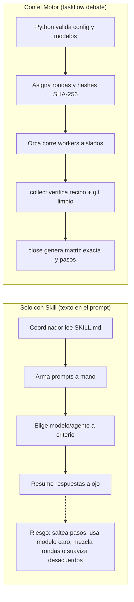
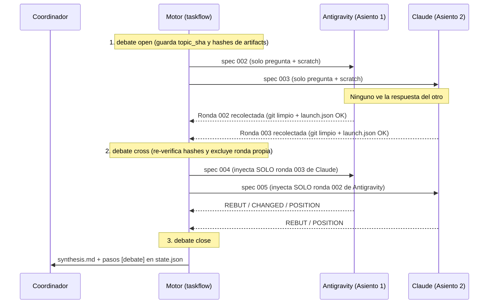
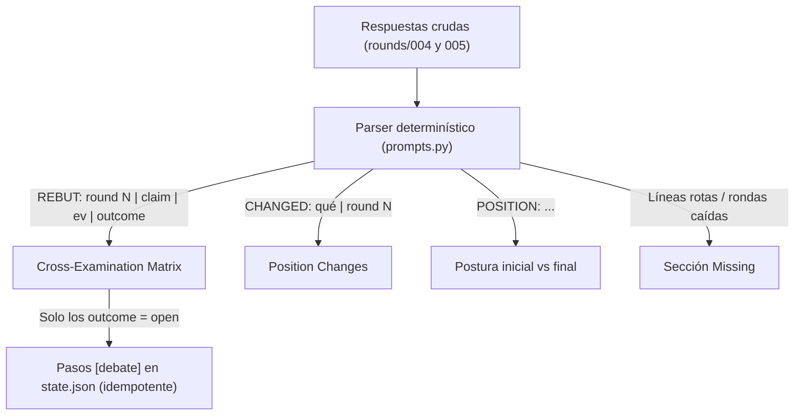

# Por qué poner las reglas en el Motor y no solo en una Skill

> [!IMPORTANT]
> Una **skill** (`SKILL.md`) es un instructivo en texto plano: le pide al agente que se porte bien.
> El **motor** (`ai-governance` / `taskflow`) es código Python determinístico: **no confía** en la buena voluntad del agente y frena antes de que algo salga mal (*fail-closed*).

---

## 1. La diferencia de fondo en un vistazo



---

## 2. Qué ganás en concreto (con ejemplos reales)

### A. Control estricto de modelos y costos (`denied_models` + `--effort`)

* **Con una skill:** podés escribir *"no uses modelos caros"*, pero si el agente coordinador se olvida el flag o pasa un alias viejo, el worker arranca igual y te gasta cuota.
* **Con el motor:**
  1. Antes de reservar una ronda, `config.py` resuelve el modelo real (explícito o por defecto) y lo cruza contra `taskflow.denied_models`.
  2. Un repo **nunca** puede aflojar la lista negra del usuario; solo puede agregar más modelos prohibidos.
  3. Al terminar el worker, `collect.py` abre `launch.json` de Orca y verifica **qué modelo lanzó realmente** (si falta el recibo, está corrupto o es una tubería falsa, rechaza la recolección).

**Ejemplo real de nuestra prueba en vivo:**
```text
AI_GOVERNANCE_DENIED_MODELS="gemini-3.8-flash" \
  ai-governance taskflow debate debate-demo-d4 open --agents antigravity,claude ...

→ ERROR: seat 'antigravity': model 'gemini-3.8-flash' is denied by taskflow.denied_models
```
Ni siquiera llegó a abrir Orca: cortó antes de escribir un solo archivo.

---

### B. Aislamiento real y cero "teléfono descompuesto" en el debate



* **Con una skill:** el coordinador tiene que copiar, pegar y acordarse de no mostrarle a Claude lo que escribió Claude, ni pasarle un archivo que cambió entre rondas.
* **Con el motor:**
  * `open` calcula el `SHA-256` del archivo de tema y de cada `--artifact`. Si alguien edita el documento en el medio, `cross` frena con error porque estarían debatiendo sobre cosas distintas.
  * Cada `spec.md` de `cross` recibe únicamente las rondas válidas de los **otros** proveedores.
  * Si un asiento falla al arrancar (como pasó con `codex` cuando faltó en el `PATH` de Orca), `cross` lo descarta solo con un `WARN` y sigue si quedan al menos 2 proveedores distintos.

---

### C. Verificación dura al recolectar (`collect`)

Cuando termina un worker, una skill asume que "si dijo que terminó, está todo bien". El motor comprueba cuatro cosas antes de aceptar la ronda:

1. **Recibo de token (`receipt.txt`):** confirma que respondió exactamente el worker de esa ronda y no uno viejo.
2. **Recibo de Orca (`launch.json`):** confirma proveedor y modelo lanzado.
3. **Árbol de Git intacto (`stamp`):** verifica que un agente lector/debatiente **no modificó archivos del repo**.
4. **Lectura segura de archivos:** abre archivos de ronda y recibos verificando que sean archivos regulares (con `O_NONBLOCK` + `S_ISREG`) para que nadie pueda colgar el proceso con un FIFO o un symlink raro.

---

### D. Síntesis matemática en vez de resumen "a ojo"



* **En nuestra corrida real con Orca:**
  * Claude refutó dos supuestos de Antigravity citando líneas exactas (`control.py:82` y `store.py:89-96`).
  * Antigravity ajustó su argumento con `CHANGED:` al verificar `models.py:64-65`.
  * `synthesis.md` armó automáticamente la matriz (`2 / 1 / 0` y `2 / 2 / 0`) sin que ningún LLM pudiera "dibujar" o suavizar los números.
  * Si corrés `debate close` dos veces seguidas, los pasos `[debate]` **no se duplican**.

---

### E. Ahorro de tokens y contexto en tu sesión principal

| Tarea | Solo con Skill | Con el Motor |
|---|---|---|
| Cargar instrucciones del flujo | Ocupa contexto en cada turno | Vive en Python fuera del prompt |
| Armar prompts y rutas de ronda | Lo piensa y redacta el modelo | Lo genera `dispatch.py` en milisegundos |
| Validar quién se contradijo o qué quedó abierto | El modelo principal relee todo | `synthesis.py` extrae la matriz exacta |
| Bloquear cambios accidentales en el repo | Confía en que el agente obedezca | Lo corta `collect.py` comparando hashes |

---

## 3. Cuándo usar cada herramienta

> [!TIP]
> No todo necesita el motor completo. Usá la herramienta más liviana que te dé el nivel de garantía que buscás.

| Situación | Qué conviene usar | Por qué |
|---|---|---|
| Duda rápida o brainstorm informal | **Skill / subagente** | Cero fricción, no necesitás trazabilidad formal. |
| Decisión de arquitectura con impacto | **`taskflow debate`** | Obliga 2+ proveedores distintos, evidencia trazable y `synthesis.md`. |
| Edición simple en una rama conocida | **Calidad local (`ws check`)** | Rápido, determinístico y sin tracking pesado. |
| Ticket formal con revisión cruzada | **Taskflow completo** | Bloqueos independientes (`validator`/`judge`) y registro de aprobaciones. |
