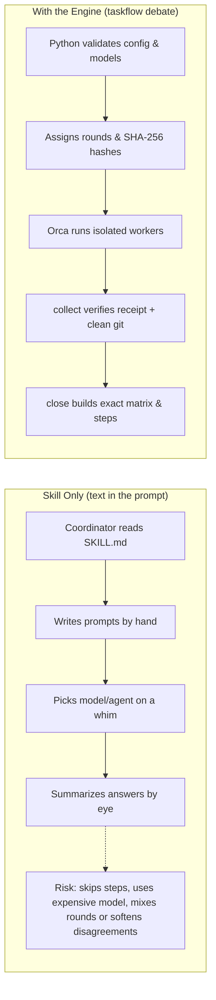
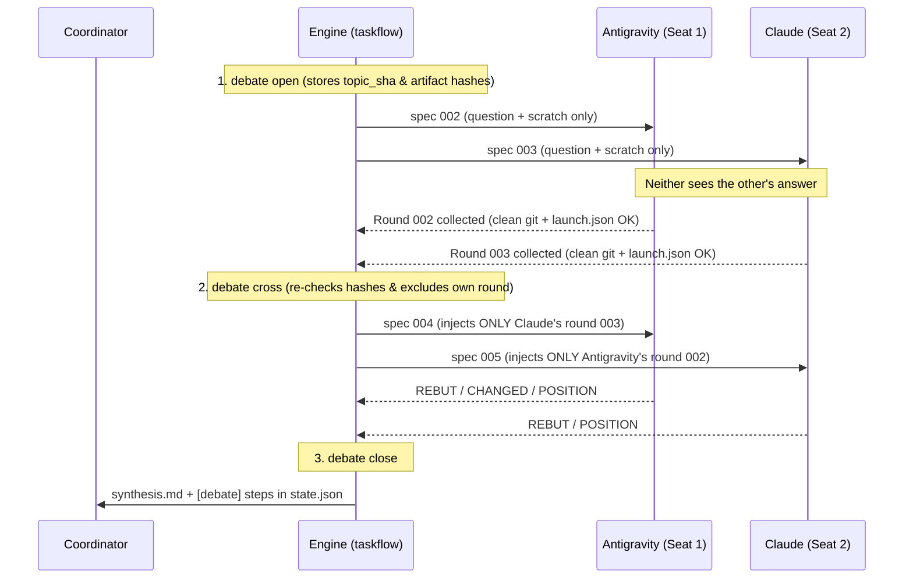
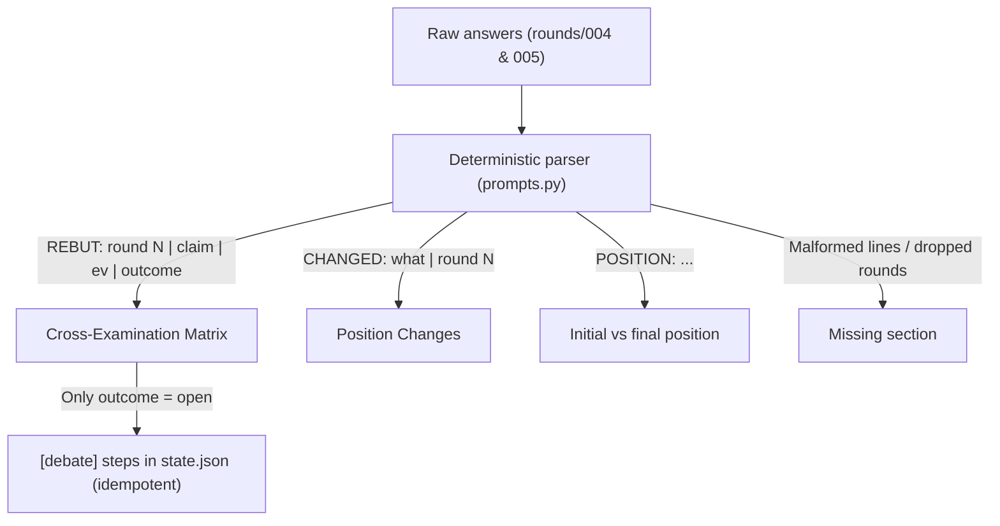

# Why Put Rules in the Engine Instead of Only in a Skill

> [!IMPORTANT]
> A **skill** (`SKILL.md`) is a plain-text guide: it asks the agent to behave well.
> The **engine** (`ai-governance` / `taskflow`) is deterministic Python code: it **does not rely** on the agent's goodwill and stops before something goes wrong (*fail-closed*).

---

## 1. The Core Difference at a Glance



---

## 2. What You Gain in Practice (Real Examples)

### A. Strict Model & Cost Control (`denied_models` + `--effort`)

* **With a skill:** you can write *"don't use expensive models"*, but if the coordinator agent forgets the flag or passes an old alias, the worker still launches and burns quota.
* **With the engine:**
  1. Before reserving a round, `config.py` resolves the actual model (explicit or default) and checks it against `taskflow.denied_models`.
  2. A repository can **never** relax the user's deny-list; it can only add more denied models.
  3. When the worker finishes, `collect.py` reads Orca's `launch.json` and verifies **which model actually launched** (if the receipt is missing, corrupt, or a FIFO/symlink, collection is rejected).

**Real example from our live run:**
```text
AI_GOVERNANCE_DENIED_MODELS="gemini-3.8-flash" \
  ai-governance taskflow debate debate-demo-d4 open --agents antigravity,claude ...

→ ERROR: seat 'antigravity': model 'gemini-3.8-flash' is denied by taskflow.denied_models
```
It didn't even open Orca: it aborted before writing a single file.

---

### B. True Isolation & Zero "Broken Telephone" in Debate



* **With a skill:** the coordinator has to copy, paste, and remember not to show Claude what Claude wrote, or pass a file that changed between rounds.
* **With the engine:**
  * `open` computes the `SHA-256` of the topic file and every `--artifact`. If someone edits a document mid-debate, `cross` aborts with an error because seats would be debating different inputs.
  * Each `cross` `spec.md` receives only the valid rounds from **other** providers.
  * If a seat fails to start (e.g., `codex` missing from Orca's `PATH`), `cross` drops it with a `WARN` and continues as long as at least 2 distinct providers remain.

---

### C. Hard Verification on Collect (`collect`)

When a worker finishes, a skill assumes "if it said it's done, everything is fine." The engine checks four things before accepting a round:

1. **Token receipt (`receipt.txt`):** confirms the exact worker for that round responded, not a stale one.
2. **Orca receipt (`launch.json`):** confirms the provider and model actually launched.
3. **Intact Git tree (`stamp`):** verifies a read-only/debating agent **did not modify repository files**.
4. **Safe file reads:** opens round files and receipts verifying they are regular files (`O_NONBLOCK` + `S_ISREG`) so a FIFO or crafted symlink cannot hang the process.

---

### D. Mathematical Synthesis Instead of "By-Eye" Summaries



* **In our live Orca run:**
  * Claude refuted two of Antigravity's assumptions citing exact lines (`control.py:82` and `store.py:89-96`).
  * Antigravity adjusted its argument with `CHANGED:` after checking `models.py:64-65`.
  * `synthesis.md` automatically built the matrix (`2 / 1 / 0` and `2 / 2 / 0`) with no LLM able to fudge or soften the numbers.
  * Running `debate close` twice does **not** duplicate `[debate]` steps.

---

## 3. Token & Context Savings in Your Main Session

| Task | Skill Only | With the Engine |
|---|---|---|
| Loading workflow instructions | Consumes context on every turn | Lives in Python outside the prompt |
| Building prompts & round paths | Thought & drafted by the model | Generated by `dispatch.py` in milliseconds |
| Checking contradictions & open points | Main model re-reads everything | `synthesis.py` extracts the exact matrix |
| Blocking accidental repo edits | Relies on agent obedience | Blocked by `collect.py` comparing hashes |

---

## 4. When to Use Each Tool

> [!TIP]
> Not everything needs the full engine. Use the lightest tool that gives you the level of guarantee you need.

| Situation | Best Tool | Why |
|---|---|---|
| Quick question or informal brainstorm | **Skill / subagent** | Zero friction, no formal traceability needed. |
| High-impact architecture decision | **`taskflow debate`** | Enforces 2+ distinct providers, traceable evidence, and `synthesis.md`. |
| Simple edit on a known branch | **Local gate (`ws check`)** | Fast, deterministic, no heavy tracking. |
| Formal ticket with cross-review | **Full Taskflow** | Independent gates (`validator`/`judge`) and approval trail. |
